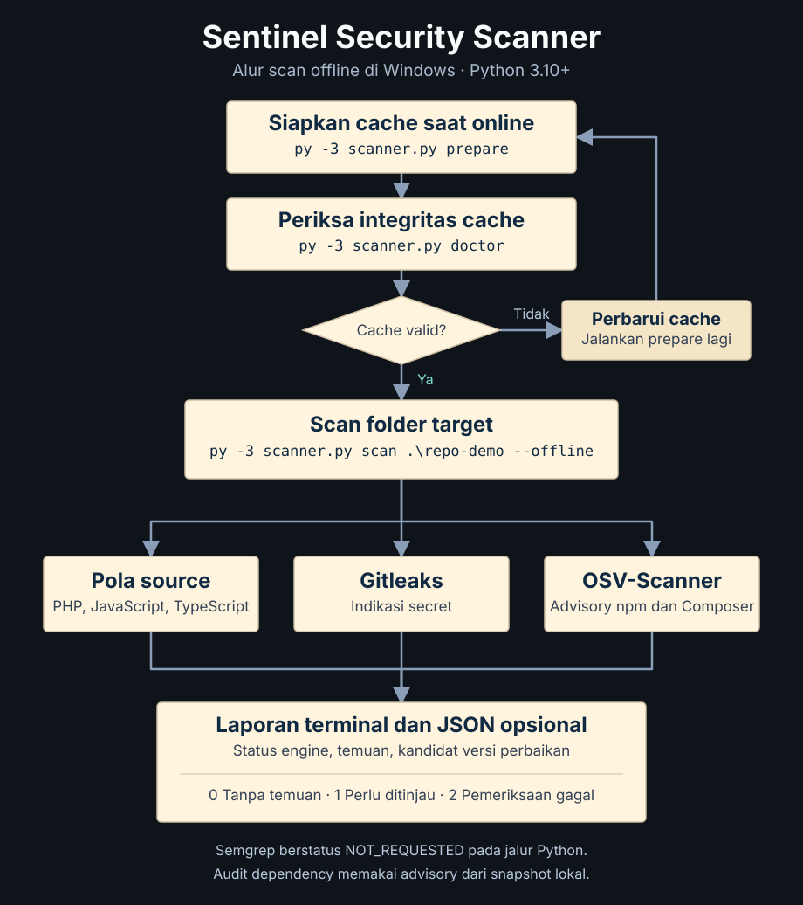

# Sentinel Security Scanner

Sentinel memindai repository lokal untuk menemukan pola kode yang berisiko, indikasi secret, dan advisory dependency. Jalankan `scanner.py` dengan **Python 3.10+**. Perintah persiapan menyimpan Gitleaks, OSV-Scanner, dan snapshot advisory ke cache lokal.

## Mulai di PowerShell

[](assets/sentinel-offline-flow.svg?raw=true)

[Buka flowchart ukuran penuh](assets/sentinel-offline-flow.svg?raw=true) untuk memperbesar diagram dengan zoom browser.

Clone repository dan jalankan persiapan saat terhubung ke internet.

```powershell
git clone https://github.com/abbyhilman/sentinel-security-scanner.git
Set-Location .\sentinel-security-scanner
py -3 scanner.py prepare
py -3 scanner.py doctor
```

`prepare` memverifikasi checksum binary dan mengunduh snapshot advisory publik untuk npm dan Composer. Jalankan lagi untuk memperbarui snapshot. `doctor` memeriksa integritas cache dan menampilkan tanggal snapshot.

Ganti path contoh dengan folder repository yang ingin Anda periksa.

```powershell
py -3 scanner.py scan 'D:\Projects\aplikasi-saya' --offline --skip-worktrees
```

Pada Linux atau macOS, gunakan `python3` sebagai pengganti `py -3`. Jalankan `py -3 scanner.py --help` untuk melihat semua perintah.

## Cakupan scan

| Pemeriksaan | Cakupan |
| --- | --- |
| Pola source | Aturan dasar untuk file PHP, JavaScript, dan TypeScript, termasuk eksekusi dinamis dan query SQL mentah. |
| Gitleaks | Indikasi secret pada file di working tree. Laporan menampilkan jenis dan lokasi indikasi dengan nilai yang disunting. |
| OSV-Scanner | Advisory pada versi dependency di `package-lock.json`, `npm-shrinkwrap.json`, `pnpm-lock.yaml`, `yarn.lock`, dan `composer.lock`. |

`scan` memakai cache lokal. Opsi `--skip-worktrees` melewati linked Git worktree di dalam folder target. Folder seperti `.git`, `node_modules`, `vendor`, dan `dist` dikecualikan dari pemindaian.

Laporan mencatat status setiap engine dan tanggal snapshot. Cakupan mode ini terbatas pada aturan dan advisory di atas. Semgrep berstatus `NOT_REQUESTED`, dan pemeriksaan secret mencakup working tree.

## Laporan dan exit code

Tampilkan hasil di terminal atau simpan laporan JSON beserta kandidat versi perbaikan yang tersedia. Gunakan nama file baru untuk setiap laporan.

```powershell
py -3 scanner.py scan 'D:\Projects\aplikasi-saya' --offline --skip-worktrees --output report-native.json
```

Tambahkan `--json` untuk menulis JSON ke stdout. Progress tetap keluar melalui stderr. Gunakan `--cache-dir` untuk memilih lokasi cache selain `.sentinel-cache` di sebelah `scanner.py`.

| Exit code | Arti |
| --- | --- |
| `0` | Tidak ada temuan pada cakupan pemeriksaan. |
| `1` | Ada temuan untuk ditinjau. |
| `2` | Perintah atau salah satu engine gagal. |

Jika cache hilang atau checksum tidak cocok, jalankan `prepare` saat online dan periksa lagi dengan `doctor`.

## Pengujian

Jalankan suite Python dari root repository.

```powershell
py -3 -m unittest discover -s tests -p test_native_scanner.py -v
```

GitHub Actions menjalankan suite yang sama di Windows dan Linux.
