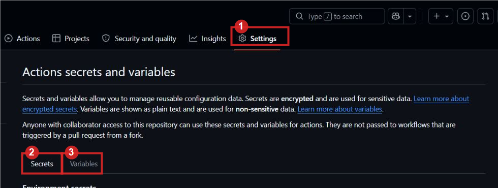
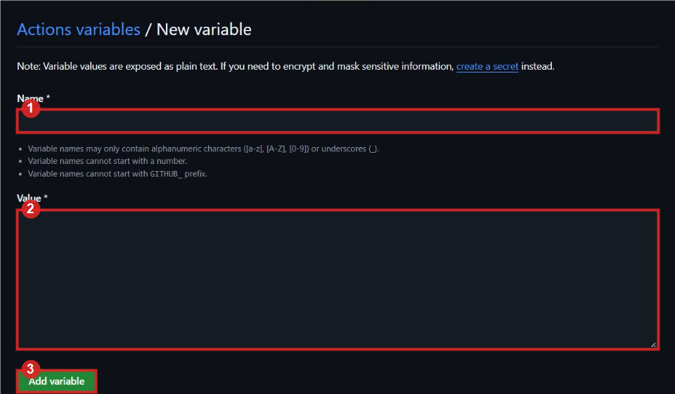
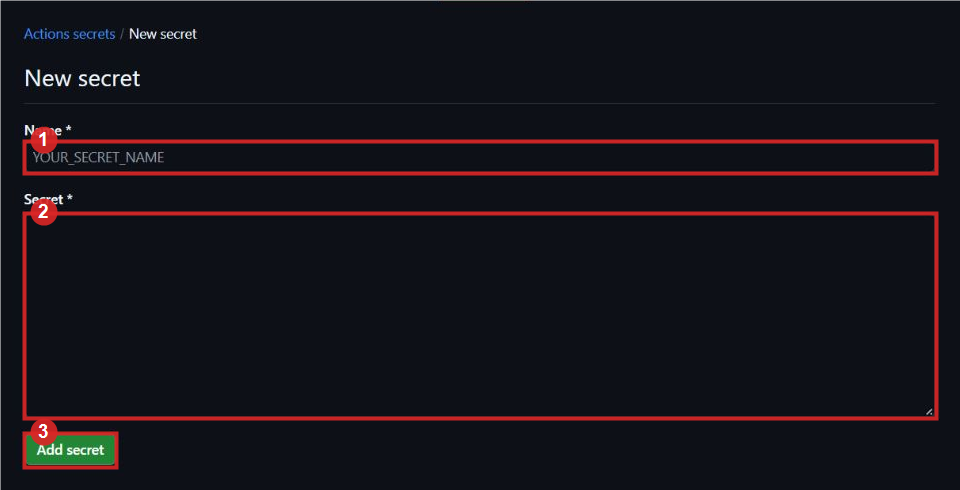

# Workflow GitHub Actions milik maintainer

Workflow ini dijalankan di repository yang dipindai dan dipasang sendiri oleh maintainer. Login GitHub ke Sentinel tidak otomatis mengimpor seluruh repository atau memasang workflow. Set file harus berada di repository target sebelum scan bisa dijalankan.

## Alur singkat

1. Tambahkan repository di dashboard Sentinel dengan nama `owner/repo` dan branch default.
2. Buka detail repository di Sentinel, buat nonce pairing, lalu salin sebelum kedaluwarsa.
3. Pasang tujuh file template ke repository target dan commit ke branch default.
4. Tambahkan URL Supabase sebagai GitHub Actions **variable** dan nonce sebagai **secret**.
5. Jalankan **Sentinel Security Scan** dari tab Actions. Pairing baru selesai setelah report pertama diterima dan status repository menjadi terverifikasi.

## 1. Pasang tujuh file template

Salin ketujuh file ini sebagai satu set. `sentinel-runner.mjs` adalah bundle hasil build adapter; jangan mengedit bundle langsung.

| File di repository Sentinel   | Lokasi di repository target                    |
| ----------------------------- | ---------------------------------------------- |
| `sentinel-scan.yml`           | `.github/workflows/sentinel-scan.yml`          |
| `sentinel-runner.mjs`         | `.github/sentinel/sentinel-runner.mjs`         |
| `gitleaks.toml`               | `.github/sentinel/gitleaks.toml`               |
| `rules/sentinel-security.yml` | `.github/sentinel/rules/sentinel-security.yml` |
| `rules/manifest.json`         | `.github/sentinel/rules/manifest.json`         |
| `rules/LICENSE`               | `.github/sentinel/rules/LICENSE`               |
| `THIRD_PARTY_NOTICES.md`      | `.github/sentinel/THIRD_PARTY_NOTICES.md`      |

Di PowerShell, dari root repository Sentinel, ganti path target lalu jalankan satu perintah:

```powershell
$targetRepo = 'D:\path\to\repository-target'
& '.\templates\github-workflows\install.ps1' -TargetRepo $targetRepo
```

Skrip menyalin tujuh file sekaligus, memeriksa konflik sebelum menulis, dan tidak melakukan commit atau push. Jika file dengan nama sama sudah ada dan berbeda, skrip berhenti. Tinjau file tersebut; gunakan `-Force` hanya jika memang ingin menggantinya. Setelah skrip selesai, periksa `git -C $targetRepo status --short`, lalu commit dan push ke branch default repository target. Docker Desktop tidak diperlukan di komputer maintainer.

Versi shell Linux/macOS:

```sh
SENTINEL_ROOT=/path/to/sentinel-security-scanner
TARGET_REPO=/path/to/repository-target
mkdir -p "$TARGET_REPO/.github/workflows" "$TARGET_REPO/.github/sentinel/rules"
cp "$SENTINEL_ROOT/templates/github-workflows/sentinel-scan.yml" "$TARGET_REPO/.github/workflows/"
cp "$SENTINEL_ROOT/templates/github-workflows/sentinel-runner.mjs" "$TARGET_REPO/.github/sentinel/"
cp "$SENTINEL_ROOT/templates/github-workflows/gitleaks.toml" "$TARGET_REPO/.github/sentinel/"
cp "$SENTINEL_ROOT/templates/github-workflows/THIRD_PARTY_NOTICES.md" "$TARGET_REPO/.github/sentinel/"
cp "$SENTINEL_ROOT/templates/github-workflows/rules/"* "$TARGET_REPO/.github/sentinel/rules/"
git -C "$TARGET_REPO" status --short
```

## 2. Atur variable dan secret di GitHub

Di repository target, buka **Settings → Secrets and variables → Actions**. Tambahkan satu repository variable dan satu repository secret. Nama harus persis sama dengan contoh di bawah.

Tampilan GitHub berikut dipotong agar fokus ke kontrol yang perlu dipilih. Nomor merah menunjukkan area yang dimaksud.



### Repository variable

Pilih tab **Variables**, lalu **New repository variable**:

| Nomor | Kolom  | Isi                                 |
| ----- | ------ | ----------------------------------- |
| 1     | Name   | `SENTINEL_SUPABASE_URL`             |
| 2     | Value  | `https://<project-ref>.supabase.co` |
| 3     | Tombol | Klik **Add variable**               |

Isi URL project saja. Jangan tambahkan `/functions/v1/sentinel-ingest`, API key, atau slash di bagian akhir. Variable dapat dibaca sebagai teks biasa, jadi jangan taruh nonce atau credential di sini.



### Repository secret

Pilih tab **Secrets**, lalu **New repository secret**:

| Nomor | Kolom  | Isi                                                                          |
| ----- | ------ | ---------------------------------------------------------------------------- |
| 1     | Name   | `SENTINEL_PAIRING_NONCE`                                                     |
| 2     | Secret | Tempel nonce sementara yang sedang ditampilkan di detail repository Sentinel |
| 3     | Tombol | Klik **Add secret**                                                          |

Nonce berlaku 15 menit dan hanya dipakai untuk pairing pertama. Buat nonce tepat sebelum menjalankan workflow. Jangan tempel nilainya ke workflow YAML, file repository, issue, atau log. Jika kedaluwarsa, buat nonce baru di Sentinel lalu ganti secret ini. Setelah dashboard menunjukkan repository **Terverifikasi**, hapus secret nonce tersebut; scan berikutnya tidak memerlukannya.



Jangan tambahkan `service_role` key ke repository target. Workflow memakai GitHub OIDC dan tidak membutuhkan key Supabase berhak istimewa.

## 3. Jalankan workflow

Setelah tujuh file dan konfigurasi tersimpan:

1. Buka tab **Actions** pada repository target.
2. Pilih **Sentinel Security Scan**.
3. Klik **Run workflow** dan pilih branch default.
4. Tunggu job **scan** dan **report** selesai, lalu periksa status repository dan laporan di dashboard Sentinel.

Jika workflow belum muncul, pastikan file ini sudah di-commit ke branch default dengan path tepat: `.github/workflows/sentinel-scan.yml`. Workflow juga berjalan pada push ke branch default. Pull request, termasuk dari fork, tidak memicu scan.

Jika pairing belum selesai, periksa ulang URL variable, nonce secret yang belum kedaluwarsa, dan bahwa workflow dijalankan pada repository serta branch yang didaftarkan. Report pertama yang valid harus diterima agar status menjadi **Terverifikasi**.

## Pemindaian dan batasnya

- Semgrep CE `1.182.0` memakai rules Sentinel buatan sendiri berlisensi MIT. Runtime memeriksa SHA-256 ruleset yang disetujui; perubahan rules perlu ditinjau dan versi/digest disetujui ulang.
- OSV-Scanner `2.7.0` memeriksa lockfile dependency yang didukung.
- Gitleaks `8.30.1` memeriksa file checkout; nilai secret tidak dimasukkan ke report.
- Composer Audit `2.10.3` berjalan hanya jika ada `composer.lock`, tanpa `composer install`, plugin, atau script repository. Maksimal lima proyek Composer diproses dalam satu run.
- Setiap tool berjalan terpisah di container read-only dengan batas waktu, memori, proses, jaringan, dan output. Source hanya dipasang sebagai input read-only.
- Semgrep dan Gitleaks tidak mendapat akses jaringan dari container. OSV-Scanner dan Composer Audit menggunakan jaringan untuk mengambil data advisory.
- Kegagalan satu tool tidak menghentikan percobaan tool lainnya. Status `failed`, `timed_out`, dan `skipped` tetap dicatat. Hasil kosong tidak membuktikan repository aman.
- Docker Desktop lokal tidak diperlukan; container dijalankan di GitHub-hosted runner Ubuntu.

## Izin, report, dan pairing

Job **scan** hanya memiliki izin `contents: read`. Job **report** tidak melakukan checkout dan hanya meminta `id-token: write`. GitHub OIDC membuktikan identitas workflow, bukan kebenaran temuan.

Artifact `sentinel-sanitized-report` berisi JSON yang lolos schema dan sanitizer, dipertahankan tiga hari, dan dibatasi 4 MiB. JSON mentah Gitleaks berada sementara di `$RUNNER_TEMP), lalu dihapus. Log scanner tidak mencetak hasil mentah.

Saat ini migration dan Edge Functions Sentinel tersedia pada project Supabase, tetapi alur GitHub-hosted dari scan sampai report diterima belum diverifikasi end-to-end. Jangan menganggap dashboard berisi report nyata sebelum workflow pertama berhasil.

Workflow ini sengaja tidak berjalan pada event pull request. Jika trigger akan diperluas, kebijakan fork dan kredensial harus ditinjau dahulu. Status completed atau nol temuan bukan bukti keamanan penuh.
